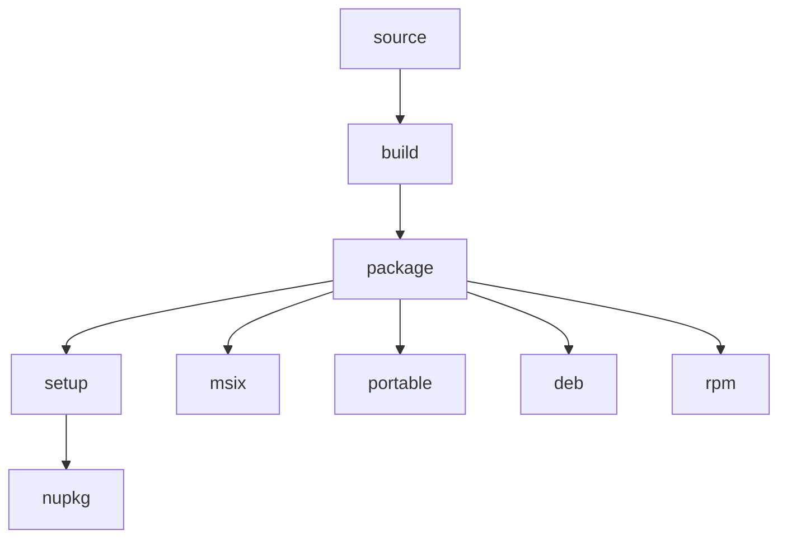

# 🛠️ bsys6

**[English](./README.md)** | [Русский](./README.ru.md)

This repository should make it easy to build LibreWolf and various things
around it, via Docker or directly on your system.

> [!IMPORTANT]
> ## This is a fork of LibreWolf bsys6
>
> This repository is a **fork of [LibreWolf bsys6](https://librewolf.dev/librewolf/bsys6)**,
> moved from Codeberg to GitHub so that work on the build system can continue here.
> Below is where the fork came from, which repositories it refers to, and what it
> changes. Details are in [FORK.md](./FORK.md).

## Where the fork came from

`bsys6` is part of LibreWolf's infrastructure, so it follows the same path as the
main repository: first GitHub, then GitLab, then Codeberg, and finally its own
Forgejo instance at `librewolf.dev`.

| Repository | Role | Link |
| --- | --- | --- |
| **`librewolf/bsys6`** (librewolf.dev) | **Canonical upstream** of the build system | <https://librewolf.dev/librewolf/bsys6> |
| **`librewolf/bsys6`** (Codeberg) | Mirror of the build system | <https://codeberg.org/librewolf/bsys6> |
| **`librewolf/source`** (librewolf.dev) | Upstream of the patches, settings and theming | <https://librewolf.dev/librewolf/source> |
| **`librewolf/source`** (Codeberg) | Mirror of the main repository | <https://codeberg.org/librewolf/source> |
| `librewolf-community/browser-linux` (GitHub) | The old GitHub home, archived | <https://github.com/librewolf-community/browser-linux> |
| **`KosenkovPro/librewolf-bsys6`** | **This fork** | <https://github.com/KosenkovPro/librewolf-bsys6> |
| **`KosenkovPro/librewolf-source`** | Fork of the main repository | <https://github.com/KosenkovPro/librewolf-source> |

## What this fork changes

The fork was created with **full history** — every commit, 154 tags and 25 branches
came across in one change. Three files are stored in Git LFS: the PGO profiles used
for optimised builds (`assets/linux.profdata`, `assets/macos.profdata`,
`assets/windows.profdata`).

These are the differences from upstream, all added by the fork:

| File | Purpose |
| --- | --- |
| [`FORK.md`](./FORK.md) | Fork description: upstream table, sync commands, working with LFS, CI settings |
| [`src/exports/forge.sh`](./src/exports/forge.sh) | The forge backend: Forgejo (the default) or GitHub, selected with `FORGE_TYPE` |
| [`.github/workflows/build-image.yml`](./.github/workflows/build-image.yml) | GitHub Actions workflow: builds the build environments and pushes them to GHCR |
| [`.github/workflows/build-release.yml`](./.github/workflows/build-release.yml) | GitHub Actions workflow: builds the packages and publishes them as a GitHub release |
| [`.github/workflows/ci.yml`](./.github/workflows/ci.yml) | GitHub Actions workflow: checks the scripts, the workflow files and the forge adapter |

The **CI is ported from Forgejo to GitHub Actions**:

- upstream builds the `librewolf.dev/librewolf/bsys6:*` images on its own runners and
  publishes the artefacts to S3 and to the Forgejo Package Registry;
- the fork builds the same images from the Dockerfiles in [`assets/`](./assets) and pushes
  them to `ghcr.io/kosenkovpro/bsys6:*`, and the packages are published as the assets of a
  GitHub release.

GitHub has no package registry for personal accounts and this fork has no S3 bucket, so
the release assets take the place of both. The Dockerfiles in [`assets/`](./assets) take a
`SOURCE_URL` build argument, so the images fetch the source archive from a GitHub release
instead of the package registry.

A full Firefox build needs about 100 GB of disk, so the build jobs expect a bigger runner
— set the repository variable `BUILD_RUNNER_JSON` to a self-hosted or a larger runner. The
details are in [`FORK.md`](./FORK.md).

Development of the build system continues here.

The original `.forgejo/workflows/` are kept as they are — they are needed for
comparison against upstream and do not interfere with GitHub Actions.

## Syncing with upstream

```bash
git fetch upstream                       # fetch changes from Codeberg
git log --oneline HEAD..upstream/master # see what changed
git merge upstream/master                # merge upstream into your branch
git push origin master                  # push the result to this fork
```

## Usage

## Disclaimer: bsys6 is currently undergoing changes and some of the documentation does not reflect the current state of the repository

Right now this repository is only meant to be used on a x86_64 Linux system.
You always run `./bsys6`, followed by a chain of commands you want to run.
The most important commands are the following,
a arrow indicates a dependency to another command:



To view all commands, run `./bsys6 help`. Commands can be customized by setting
environment variables, most importantly:

| ENV variable | Description                                                                 | Possible values (bold is default)                                                        |
| ------------ | --------------------------------------------------------------------------- | ---------------------------------------------------------------------------------------- |
| `TARGET`     | The platform you want to build for.                                         | **`linux`** `windows`                                                                    |
| `ARCH`       | The architecture that you want to build for.                                | **`x86_64`** `arm64`                                                                     |
| `VERSION`    | The version of LibreWolf to build.                                          | **`[latest version]`** [`[version tag]`](https://librewolf.dev/librewolf/source/releases) |
| `WORKDIR`    | The directory where the source code should be downloaded and compiled.      | **`~/.local/share/bsys6/work`** `[any directory]`                                        |
| `SOURCE_TAR` | Optionally, a path to a local source tarball to use instead of downloading. | `[any filepath]`                                                                         |
| `FORGE_URL`  | The forge to fetch sources and dependencies from, and publish releases to.  | **`https://librewolf.dev`** `[any forgejo/gitea instance]`                               |

## Setup

```bash
git clone https://github.com/KosenkovPro/librewolf-bsys6.git && cd librewolf-bsys6
```

> [!NOTE]
> _(optional)_ Add the checked out repository to your `PATH` to have
> `bsys6` command available everywhere.

### Build: Docker

1. Run `./bsys6_docker <COMMAND>`.
    The available commands can be found above and
    the resulting artifact will be placed in your current directory.

    This will automatically download a pre-built docker image as a build
    environment. If you want to build the image yourself, run
    `./bsys6 build_image`, optionally with the `TARGET` environment variable set
    to specify which image you want to build.

### Build: System

1. Prepare all the dependencies for your system.
    You can do that by running `./bsys6 prepare`.

    This step is only supported on Arch and Debian based systems, you will have
    to install the dependencies manually on other systems. If you want to
    cross-compile, also already set the `TARGET` environment variable to the
    platform you want to target before that to ensure all necessary dependencies
    are installed.

2. Run `./bsys6 <COMMAND>`. The available commands can be found above and the
    resulting artifact will be placed in your current directory.

## Development

### Structure

| Directory          | Contents                                                                                             | Arguments                                        | How to include |
| ------------------ | ---------------------------------------------------------------------------------------------------- | ------------------------------------------------ | -------------- |
| `src/{command}.sh` | Commands that can be run by the user with `./bsys6 {command}`. Can export new environment variables. | Via environment variable                         | With `source`  |
| `src/exports/*.sh` | Scripts that export environment variables, but shouldn't be run directly by the user.                | Via environment variable                         | With `source`  |
| `src/utils/*.sh`   | Scripts that don't export environment variables and shouldn't be run directly by the user.           | Via environment variable or positional arguments | Run directly   |

## License

This Source Code Form is subject to the terms of the Mozilla Public License, v.
2.0. If a copy of the MPL was not distributed with this file, You can obtain one
at <http://mozilla.org/MPL/2.0>.
