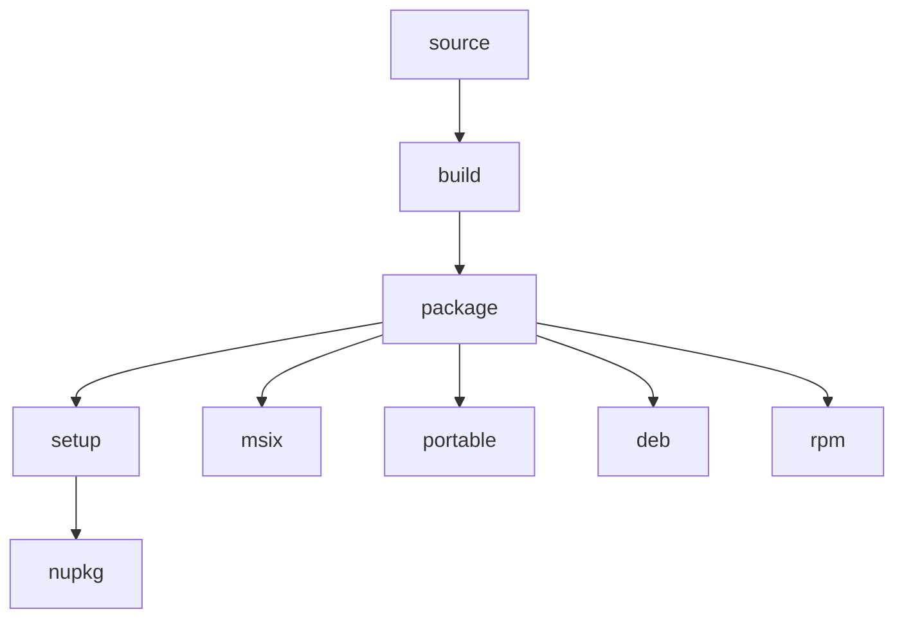

# 🛠️ bsys6

**[English](./README.md)** | **[Русский](./README.ru.md)**

Этот репозиторий должен облегчить сборку LibreWolf и всего, что вокруг него,
через Docker или напрямую на вашей системе.

> [!IMPORTANT]
> ## Это форк bsys6 из LibreWolf
>
> Этот репозиторий — **форк [LibreWolf bsys6](https://librewolf.dev/librewolf/bsys6)**,
> перенесённый с Codeberg на GitHub, чтобы продолжить разработку системы сборки
> здесь. Ниже описано, откуда взялся форк, на какие репозитории он ссылается
> и что в нём изменено. Подробности — в [FORK.md](./FORK.md).

## Откуда взялся форк

`bsys6` — часть инфраструктуры LibreWolf, поэтому он повторяет путь основного
репозитория: сначала GitHub, затем GitLab, затем Codeberg, и наконец
собственный Forgejo-инстанс на `librewolf.dev`.

| Репозиторий | Роль | Ссылка |
| --- | --- | --- |
| **`librewolf/bsys6`** (librewolf.dev) | **Каноничный upstream** системы сборки | <https://librewolf.dev/librewolf/bsys6> |
| **`librewolf/bsys6`** (Codeberg) | Зеркало системы сборки | <https://codeberg.org/librewolf/bsys6> |
| **`librewolf/source`** (librewolf.dev) | Upstream патчей, настроек и тем | <https://librewolf.dev/librewolf/source> |
| **`librewolf/source`** (Codeberg) | Зеркало основного репозитория | <https://codeberg.org/librewolf/source> |
| `librewolf-community/browser-linux` (GitHub) | Старое размещение на GitHub, архивное | <https://github.com/librewolf-community/browser-linux> |
| **`KosenkovPro/librewolf-bsys6`** | **Этот форк** | <https://github.com/KosenkovPro/librewolf-bsys6> |
| **`KosenkovPro/librewolf-source`** | Форк основного репозитория | <https://github.com/KosenkovPro/librewolf-source> |

## Что изменено в этом форке

Форк создан с **полной историей** — все коммиты, 154 тега и 25 веток перенесены
одним изменением. Три файла хранятся в Git LFS — это PGO-профили для оптимизированных
сборок (`assets/linux.profdata`, `assets/macos.profdata`, `assets/windows.profdata`).

Вот и все отличия от upstream, все они добавлены форком:

| Файл | Назначение |
| --- | --- |
| [`FORK.md`](./FORK.md) | Описание форка: таблица upstream, команды синхронизации, работа с LFS, настройки CI |
| [`src/exports/forge.sh`](./src/exports/forge.sh) | Бэкенд forge-хоста: Forgejo (по умолчанию) или GitHub, переключается через `FORGE_TYPE` |
| [`.github/workflows/build-image.yml`](./.github/workflows/build-image.yml) | Workflow GitHub Actions: собирает образы окружения сборки и отправляет их в GHCR |
| [`.github/workflows/build-release.yml`](./.github/workflows/build-release.yml) | Workflow GitHub Actions: собирает пакеты и публикует их как GitHub Release |
| [`.github/workflows/ci.yml`](./.github/workflows/ci.yml) | Workflow GitHub Actions: проверяет скрипты, файлы workflow и адаптер forge-хоста |

**CI перенесён с Forgejo на GitHub Actions**:

- upstream собирает образы `librewolf.dev/librewolf/bsys6:*` на собственных раннерах и
  публикует артефакты в S3 и Package Registry Forgejo;
- форк собирает те же образы из Dockerfile-ов в каталоге [`assets/`](./assets) и
  отправляет их в `ghcr.io/kosenkovpro/bsys6:*`, а пакеты публикуются как ассеты
  GitHub Release.

У GitHub нет Package Registry для личных аккаунтов, а S3-бакет у форка отсутствует, поэтому
оба места заменены ассетами релиза. Dockerfile-ы в каталоге [`assets/`](./assets) принимают
build-аргумент `SOURCE_URL`, поэтому образы берут source-тарбол из GitHub Release, а не из
package registry.

Полная сборка Firefox требует около 100 ГБ диска, поэтому для сборочных заданий нужен
более мощный раннер — задайте переменную репозитория `BUILD_RUNNER_JSON` (self-hosted
или раннер большего размера). Подробности в [`FORK.md`](./FORK.md).

Развитие системы сборки ведётся здесь.

Оригинальные `.forgejo/workflows/` сохранены как есть — они нужны для сверки
с upstream и не мешают GitHub Actions.

## Синхронизация с upstream

```bash
git fetch upstream                              # забрать изменения с Codeberg
git log --oneline HEAD..upstream/master         # посмотреть, что изменилось
git merge upstream/master                       # влить upstream в свою ветку
git push origin master                          # отправить результат в этот форк
```

## Использование

> [!NOTE]
> > **Дисклеймер:** bsys6 сейчас в стадии изменений, и часть документации
> > не отражает текущее состояние репозитория.

Сейчас репозиторий рассчитан на использование только в x86_64 Linux.
Вы всегда запускаете `./bsys6`, а затем — цепочку нужных команд.
Основные команды таковы,
стрелка означает зависимость от другой команды:



Полный список команд — `./bsys6 help`. Команды настраиваются переменными
окружения, важнейшие из них:

| Переменная | Описание | Возможные значения (**жирным** — по умолчанию) |
| ---------- | -------- | ------------------------------------------------- |
| `TARGET` | Платформа, для которой выполняется сборка. | **`linux`** `windows` |
| `ARCH` | Архитектура, для которой выполняется сборка. | **`x86_64`** `arm64` |
| `VERSION` | Версия LibreWolf для сборки. | **`[последняя версия]`** [`[тег версии]`](https://librewolf.dev/librewolf/source/releases) |
| `WORKDIR` | Каталог, куда скачиваются и собираются исходники. | **`~/.local/share/bsys6/work`** `[любой каталог]` |
| `SOURCE_TAR` | Необязательный путь к локальному source-тарболу вместо загрузки. | `[любой путь]` |
| `FORGE_URL` | Фордж, из которого забираются исходники и зависимости и куда публикуются релизы. | **`https://librewolf.dev`** `[любой инстанс forgejo/gitea]` |

## Установка

```bash
git clone https://github.com/KosenkovPro/librewolf-bsys6.git && cd librewolf-bsys6
```

> [!NOTE]
> _(необязательно)_ Добавьте склонированный репозиторий в `PATH`,
> чтобы команда `bsys6` была доступна везде.

### Сборка: Docker

1. Выполните `./bsys6_docker <КОМАНДА>`.
    Список доступных команд — выше,
    а готовый артефакт окажется в текущем каталоге.

    Команда автоматически скачает готовый Docker-образ как окружение сборки.
    Чтобы собрать образ самостоятельно, выполните
    `./bsys6 build_image`, при необходимости задав переменную `TARGET`
    для выбора нужного образа.

### Сборка: на системе

1. Подготовьте все зависимости для своей системы.
    Это можно сделать так:

    ```bash
    ./bsys6 prepare
    ```

    Этот шаг поддерживается только на системах на базе Arch и Debian;
    на остальных зависимости нужно установить вручную. Чтобы кросс-компилировать,
    задайте `TARGET` для нужной платформы до этого шага — так зависимости
    установятся под нужную архитектуру.

2. Выполните `./bsys6 <КОМАНДА>`. Готовый артефакт окажется
    в текущем каталоге.

## Разработка

### Структура

| Каталог | Содержимое | Аргументы | Как подключить |
| ------- | ---------- | --------- | -------------- |
| `src/{command}.sh` | Команды, которые пользователь запускает через `./bsys6 {command}`. Могут экспортировать новые переменные окружения. | Через переменную окружения | Через `source` |
| `src/exports/*.sh` | Скрипты, экспортирующие переменные окружения, но не запускаемые напрямую пользователем. | Через переменную окружения | Через `source` |
| `src/utils/*.sh` | Скрипты, не экспортирующие переменные окружения и не запускаемые напрямую пользователем. | Через переменную окружения или позиционные аргументы | Запуск напрямую |

## Лицензия

Исходный код распространяется на условиях Mozilla Public License v. 2.0.
Копию MPL можно получить на <http://mozilla.org/MPL/2.0/>.
